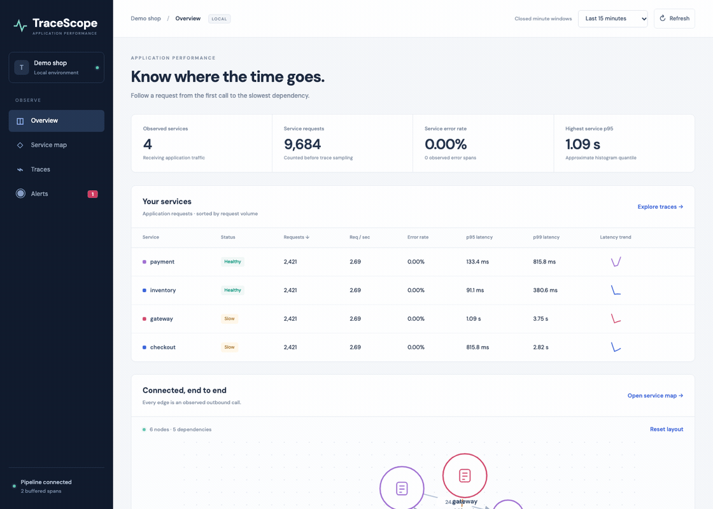
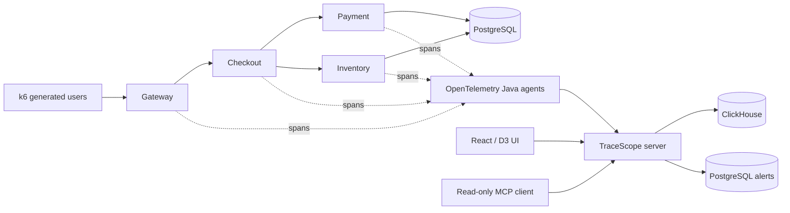

# TraceScope

Follow a slow request from the service map to the database call behind it.

TraceScope is a single-node application performance monitoring application built with Java, Spring Boot, React, D3, OpenTelemetry and ClickHouse. Four real Java services handle generated HTTP traffic and PostgreSQL queries. The OpenTelemetry Java agent produces the traces; TraceScope assembles, aggregates, stores and visualizes them.



Recorded from the local instrumented demo. This shows the UI flow; [verification results](reports/verification.md) separately record failed and pending runtime gates.

## Run locally

Requires Docker with Compose, approximately 6 GiB available Docker memory and four CPUs, plus enough host memory to avoid active swapping during measurement. Application images build from source; a host JDK or Node installation is not required for this path.

```sh
make dev
make load
```

Open [TraceScope](http://localhost:3000). The default load is 20 checkout requests per second for five minutes. Metrics use **closed UTC minute windows**, so new traffic appears after the minute closes and aggregates flush. Retained trace lookup becomes available earlier.

Ports are loopback-only: UI `3000`, backend/MCP `8080`, gateway `8081`, checkout `8082`, payment `8083`, inventory `8084`. Override `WEB_PORT`, `SERVER_PORT`, `GATEWAY_PORT`, `CHECKOUT_PORT`, `PAYMENT_PORT` and `INVENTORY_PORT` if needed. PostgreSQL and ClickHouse are not published on host ports.

Stop with `make down`; database volumes persist. Default credentials and tokens are for local synthetic data. This setup has no user login and is not an internet-facing service.

## Investigate a fault

Start another load run, then slow payment:

```sh
python3 scripts/fault.py payment --latency-ms 800
```

Open **Service map**, follow the slow checkout → payment edge, then open a slow trace from payment's service page. The waterfall attributes synchronous critical-path time to payment. After the configured measurement window and sustained breach period, the checkout latency alert includes example traces.

Other scenarios:

```sh
python3 scripts/fault.py payment --db-slow-ms 600
python3 scripts/fault.py inventory --error-rate 0.2
python3 scripts/fault.py checkout --downstream-down inventory
make reset
```

Each command replaces that service's current fault configuration. `make reset` clears faults and their injection counters; it preserves recorded telemetry. With custom ports, set `PAYMENT_URL`, `INVENTORY_URL` and `CHECKOUT_URL` for the fault helper.

## Agent investigation

The read-only MCP server uses Streamable HTTP and a bearer token:

```sh
claude mcp add --transport http tracescope http://localhost:8080/mcp \
  --header 'Authorization: Bearer local-mcp-token'
```

Ask the agent to investigate slow checkout requests. Tools expose service health, dependencies, slow/error traces, compact trace summaries and alert events. Outputs are bounded JSON with an attribute allowlist. The static token is configured with `MCP_TOKEN`; the transport is not a multi-user authorization system.

## How it works



Request metrics count received SERVER/CONSUMER spans and root INTERNAL transactions before trace sampling. Parentless outbound JDBC spans and health/control routes do not inflate application request counts. Span identities are deduplicated before aggregation within a bounded process-local window.

Mergeable histograms combine raw duration counts across services and effective time windows. Finite-bucket quantiles have an approximately 4.9% relative error bound; underflow and overflow are explicitly flagged. Percentiles are never averaged.

The pipeline bounds active/queued spans, estimated retained bytes, identity entries, aggregation keys and writer frames. Storage outages retain bounded frames and apply admission backpressure. Aggregate retries reuse stable insert identities. None of this supplies durable replay after a process crash.

## Verification

The suites cover duplicate deliveries, acknowledgment loss, bounded outages, late spans, real OTLP export, histogram properties, dependency classification, persisted alert timers, MCP protocol sessions and browser investigation.

- [Model and compatibility](reports/phase-1.md)
- [Real-agent vertical slice](reports/phase-2.md)
- [UI, alerts and MCP](reports/phase-3.md)
- [Testing instructions and evidence limits](docs/TESTING.md)
- [Current verification results](reports/verification.md)
- [Independent engineering review](reports/review.md)
- [Recorded MCP investigations](docs/mcp-session.md)

Full fault acceptance and Kubernetes verification are tracked separately from source review. Current failures and pending gates are recorded in the verification report. No remote CI success is claimed before a workflow actually runs.

## Kubernetes

The Helm chart runs the same images on one local kind node. It enforces one server replica and supplies probes, resource limits, non-root pod settings and persistent database volumes.

```sh
python3 scripts/install-local-tools.py
make build
make kind
```

The verification script installs into a fresh project-owned cluster, runs a real k6 Job, checks the service-map API and nginx proxy, and reports the kubeconfig path when the cluster is retained. See [deployment instructions](docs/DEPLOYMENT.md) for access and cleanup.


